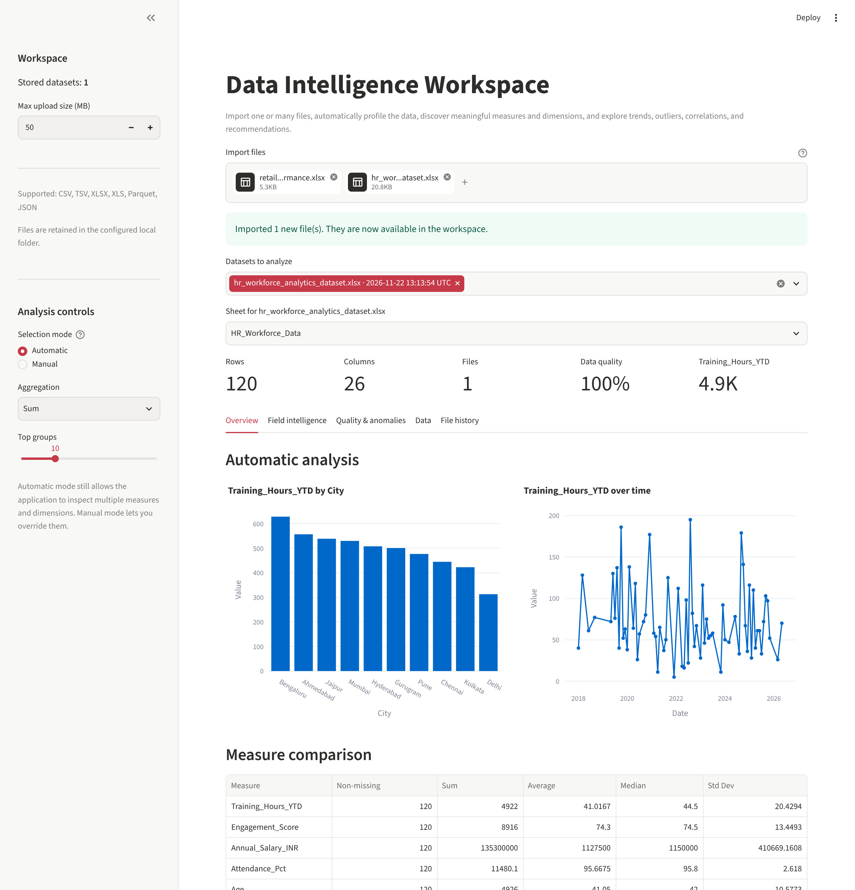
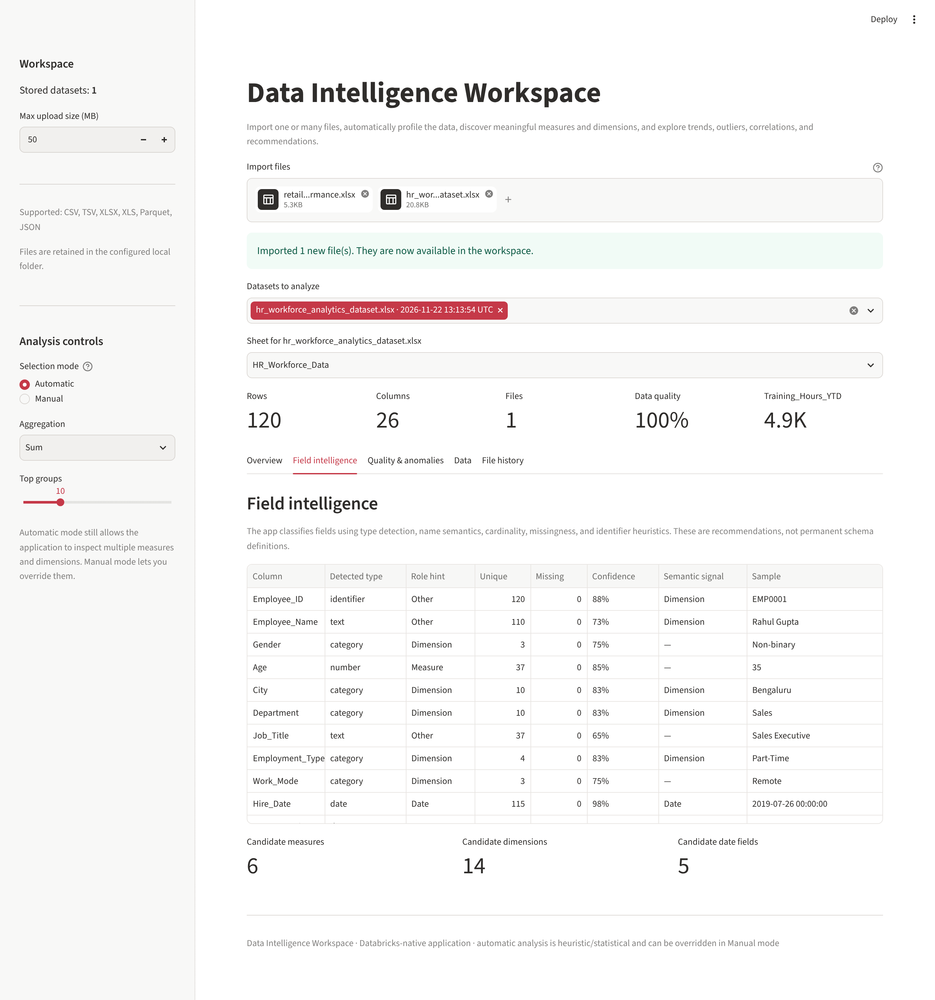
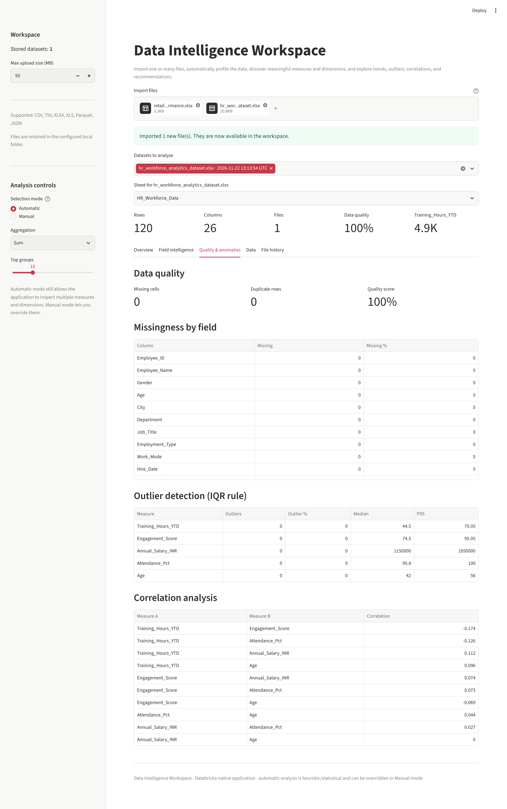
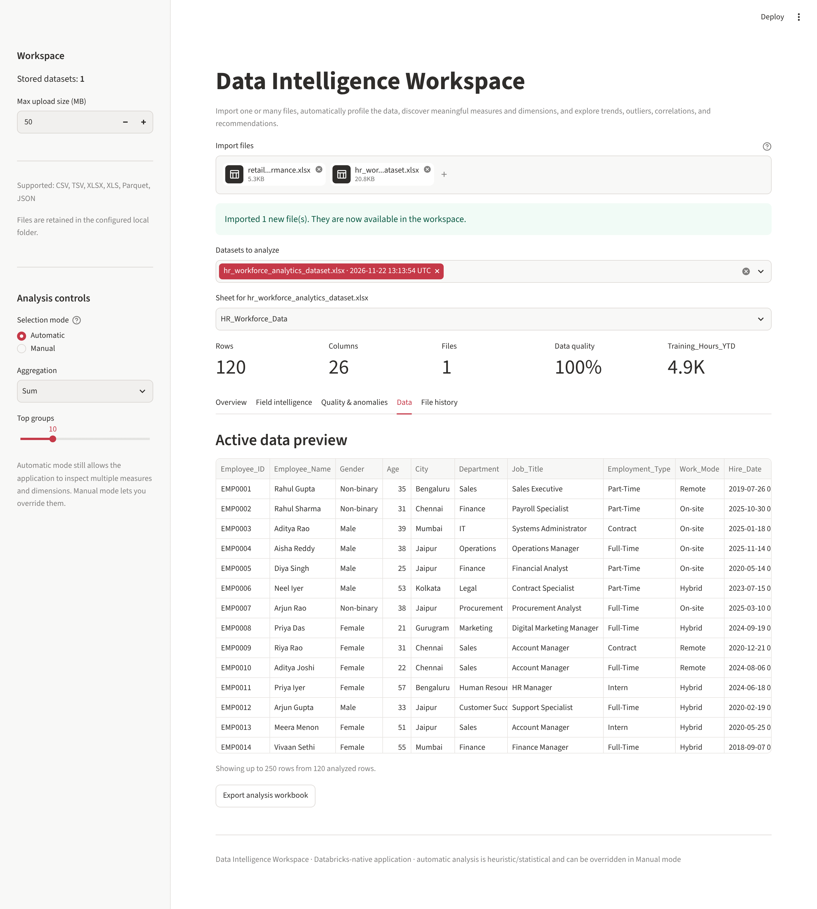
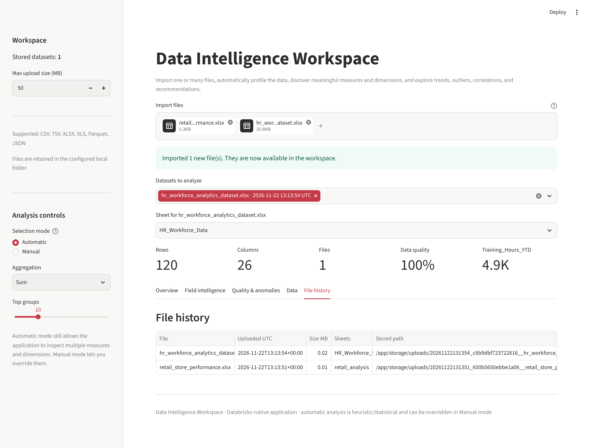
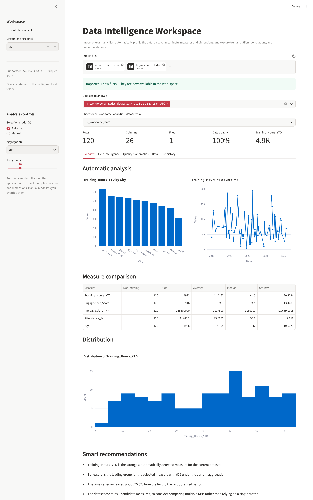

# 📊 Data Intelligence Workspace

[](https://github.com/prashantpandey120143/data-intelligence-workspace/actions/workflows/ci.yml)


**Drop in any CSV, Excel, Parquet or JSON file and get an instant analytics workspace** — automatic data profiling, smart detection of measures / dimensions / dates, charts, anomaly detection, correlations, plain-English recommendations and a one-click Excel report. No configuration, no code.

Built as a **Databricks-native Streamlit app** (files persist in a Unity Catalog Volume) that also **runs locally with a single command**.



## ✨ Features

| Area | What it does |
|---|---|
| **Multi-file workspace** | Upload many files; they persist between sessions. Combine several datasets into one analysis (adds `_source_file`, `_ingested_at` columns). |
| **Duplicate protection** | Content-hash (SHA-256) check stops the same file being stored twice. |
| **Formats** | CSV, TSV, XLSX, XLS, Parquet, JSON — with per-workbook sheet selection. |
| **Field intelligence** | Infers each column's type and role (measure / dimension / date / identifier) from data type, name semantics, cardinality and missingness, with a confidence score. |
| **Automatic analysis** | Picks the best measures, group-by field and date field, then renders KPIs, a grouped comparison chart, a time-series trend, a distribution histogram and a measure comparison table. |
| **Manual override** | Choose your own measures, group-by, date field, aggregation (Sum / Avg / Median / Min / Max / Count) and top-N. |
| **Data quality** | Missing-value and duplicate-row analysis, quality score, IQR-based outlier detection, pairwise correlations. |
| **Recommendations** | Deterministic, rule-based business insights generated from the results (no LLM calls, fully reproducible). |
| **Export** | Multi-sheet Excel workbook: data, summary, field intelligence, groups/trends, outliers, correlations, recommendations. |

## 🖼️ Screenshots

| Field intelligence | Quality & anomalies |
|---|---|
|  |  |

| Data preview & export | File history |
|---|---|
|  |  |

<details><summary>Full overview page</summary>


</details>

## 🚀 Quick start (local)

```bash
git clone https://github.com/prashantpandey120143/data-intelligence-workspace.git
cd data-intelligence-workspace
python -m venv .venv && source .venv/bin/activate   # Windows: .venv\Scripts\activate
pip install -r requirements.txt
streamlit run app.py
```

Open http://localhost:8501 and upload a file from [`sample_data/`](sample_data/) to try it. Uploads are stored in `./.local_storage/` (git-ignored). Set `LOCAL_STORAGE_DIR` to change the location.

## ☁️ Deploy on Databricks Apps

The app switches to Unity Catalog Volume storage automatically when a `VOLUME_URI` resource is attached. Full walkthrough: **[docs/DEPLOYMENT.md](docs/DEPLOYMENT.md)**. In short:

1. Run [`sql/00_create_storage.sql`](sql/00_create_storage.sql) once to create the schema and volume.
2. Create a Databricks App with `app.py`, `app.yaml`, `requirements.txt`.
3. Add a *UC volume* resource with key `volume` (`Can read and write`) and deploy.

## 🧱 Architecture

```
Browser ── Streamlit UI (app.py)
              │
              ├─ Ingestion      read_dataset / inspect_file / content-hash dedupe
              ├─ Inference      infer_fields → rank_fields (measures, dimensions, dates)
              ├─ Analytics      aggregate_by_group / over_time · outliers · correlations
              ├─ Insights       build_recommendations (rule-based)
              ├─ Export         build_export → multi-sheet .xlsx
              └─ Storage layer  volume_read/write/list
                                 ├─ Databricks: Unity Catalog Volume via SDK Files API
                                 └─ Local: ./.local_storage  (default when VOLUME_URI unset)
```

Storage layout (under the volume / local folder): `uploads/` raw files · `metadata/` one JSON record per upload · `exports/` generated reports.

## 🧪 Sample data

[`sample_data/`](sample_data/) contains three **fully synthetic** datasets (no real people or companies): HR workforce (120 rows × 24 cols), retail store performance, and hotel occupancy. The hotel file includes one misaligned row, which is handy for seeing the quality checks work.

## ⚙️ Limits & design notes

- In-session analysis is capped at **500,000 rows**; upload limit defaults to 50 MB (adjustable to 200 MB in the sidebar).
- Automatic analysis is heuristic/statistical — treat it as a strong starting point and use **Manual mode** to override.
- Recommendations are template-driven rules, intentionally deterministic.

## 🛠️ Tech stack

Python · Streamlit · pandas · Plotly · openpyxl / xlrd · PyArrow · Databricks SDK · Unity Catalog Volumes · GitHub Actions

## 🗺️ Roadmap ideas

- Per-user storage isolation / auth-aware catalog
- Pluggable insight rules and custom KPI definitions
- Unit tests for the inference and analytics functions (currently a startup smoke test)
- Delta table export alongside Excel

## 👤 Author

**Prashant Pandey** — [GitHub](https://github.com/prashantpandey120143)

Licensed under the [MIT License](LICENSE).
